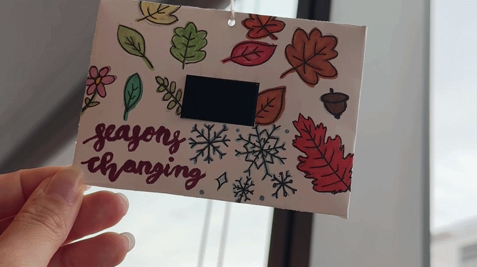

# Module 1: Changing Seasons

In this project, we learned how to code on a LilyGo TTGO T-display ESP32 to create generative art. I created generative art showcasing our theme, "transitions", through the changing seasons. The display shows a green leaf (representing spring/summer), followed by colorful leaves (fall), and snowflakes (winter).

You can read more at [this blog article](https://app.notion.com/p/Module-1-Generative-Art-Changing-Seasons-3efd5c8d2dcb8087b947d4bbdc20f225?source=copy_link), which details how this was implemented, my design process, and technical challenges.

## Project GIF

## Recreating the project

To recreate this project, you will need a LilyGo TTGO T-display ESP32 device, alongside a USB-C to USB-C cable. Make sure that this cable is able to transmit data, rather than simply power the device.

### Setup
1. Download the [Arduino IDE](https://www.arduino.cc/en/software/).
2. Install the [TTGO T-Display driver](https://github.com/Xinyuan-LilyGO/TTGO-T-Display). Make sure that it is the correct `CHxxx Series driver`. On a Mac, you will need to go to `Privacy and Security` in your settings to allow the driver app to install.
3. Install the `tft_espi` by Bodmer library, in `Tools > Manage Libraries`. Click the install button to install.
4. Navigate to the library, in `.../Arduino/libraries/tft_espi`. Open up `User_Setup_Select.h` and comment out the line `#include <User_setup.h>`. Uncomment the line `include <User_Setups/Setup25_TTGO_T_Display.h>`
5. Install the [ESP32 library](https://docs.espressif.com/projects/arduino-esp32/en/latest/installing.html), under `Installing using Arduino IDE`.
6. Set the Arudino upload settings:
`Tools > Boards > esp32 > ESP32 Dev Module`
`Tools > Port > your_port` - on Mac, this should be `wchusb`
`Tools > Upload Speed > 115200`

More detailed instructions can be found [here](https://comsbc3930-fall-2026.notion.site/Lab-1-TFT-Display-903350cc6f0582eabcf38175506b2c68).

### Code
1. Clone this Github repository
2. Open `module1.ino` from the `coms3930-module-1` folder in the Arduino IDE. If prompted, allow Arduino IDE to create a matching `module1` sketch folder.
3. Upload the sketch to the ESP32. 

### Display
There must be a power source in order for the art to show. You can connect a LiPo battery in order to display the art without a laptop. To hang up and display the ESP32, with a decorative paper frame, you can follow the steps linked [here](https://comsbc3930-fall-2026.notion.site/Module-1-Install-Instructions-e5c350cc6f05827ca6588112ef0cc516). This creates a hanging display with a popsicle stick, paper (cut to size, to wrap around the ESP32), and string.
